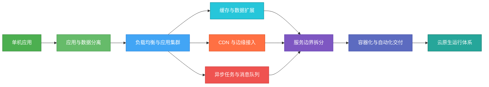
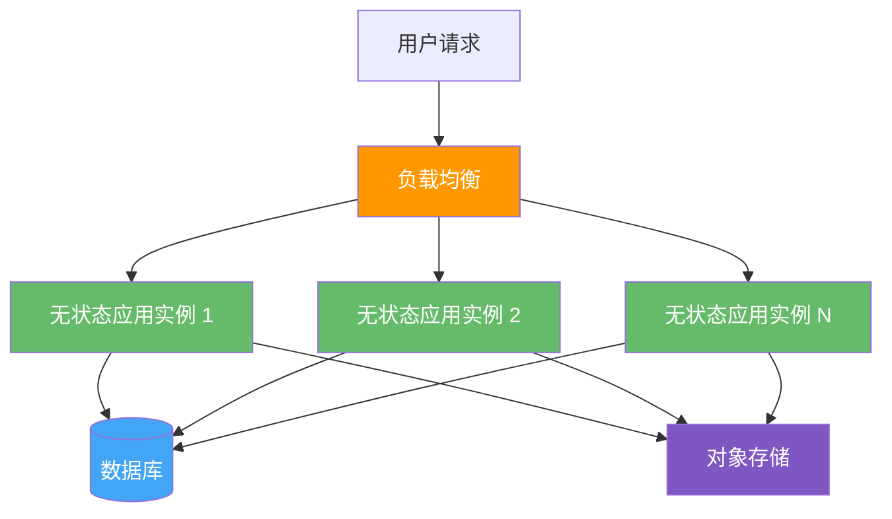
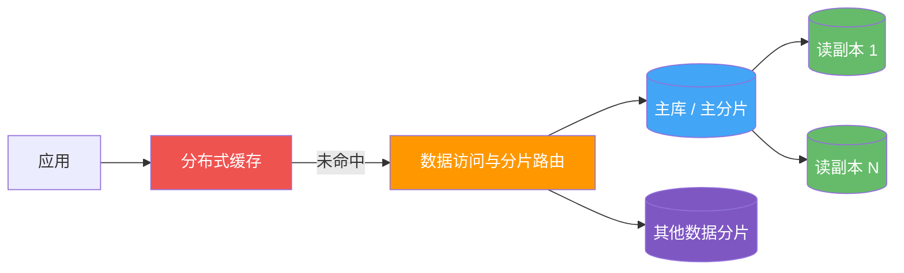
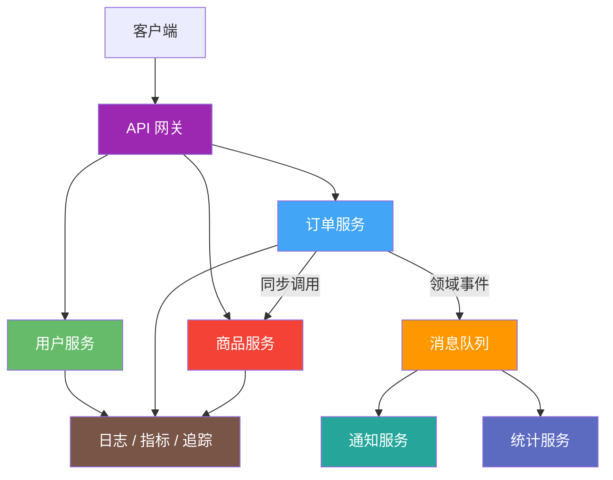

互联网架构并不存在一条所有公司都必须照搬的升级路线。缓存、CDN、消息队列、分库分表和微服务解决的是不同维度的问题，它们可能同时出现，也可能永远不需要。

本文给出的是一条便于理解的常见路径：随着流量、数据量、可用性要求和团队规模增长，系统如何逐步拆分职责，以及每次升级又会引入什么新成本。
{: .prompt-info }

## 架构演进全景图



这张图表示能力逐步叠加，不代表严格的时间顺序。例如，静态内容较多的单体应用也可以很早使用 CDN；数据量不大的微服务系统则未必需要分库分表。

---

## 一、从单机到应用集群

### 1. 单机架构

产品早期用户少，把应用、数据库和文件放在同一台服务器上，搭建快、成本低，也方便排查问题。

它的主要限制不是「技术落后」，而是所有资源和故障集中在一台机器：CPU、内存、磁盘互相争用，任何一次宕机都可能让整个服务不可用。

### 2. 应用与数据分离

当数据库和文件读写开始影响应用响应时，可以先拆分部署：应用服务器处理请求，数据库负责结构化数据，对象存储或文件服务保存静态文件。

这一步增加了网络调用和多机运维成本，但让不同资源可以独立扩容，也缩小了单机故障的影响范围。

### 3. 负载均衡与应用集群

单台应用服务器达到容量上限后，可以在负载均衡后部署多个应用实例。应用层要尽量无状态，会话放入共享存储或通过令牌携带，上传文件也不能只留在某一台实例本地。



| 变化 | 解决的问题 | 新增成本 |
| --- | --- | --- |
| 应用与数据分离 | 资源隔离、独立扩容 | 网络延迟、多机运维 |
| 应用集群 | 单机容量与可用性 | 无状态改造、流量调度 |
| 共享存储 | 多实例数据一致 | 存储可用性与访问延迟 |

---

## 二、数据访问能力扩展

数据层通常不会一次性完成「缓存、读写分离、分库分表」全部改造，而是先确认真正的瓶颈，再选择成本最低的方案。

### 1. 多级缓存

浏览器或 CDN 缓存静态内容，应用进程缓存小而稳定的数据，Redis 等分布式缓存承接跨实例热点查询。缓存可以降低数据库压力，但也引入失效策略、一致性、穿透、击穿和雪崩问题。

缓存不是权威数据源。关键数据仍要能够从数据库重建，更新链路也要明确采用旁路缓存、失效通知还是其他一致性策略。

### 2. 读副本

当查询负载明显高于写入负载时，可以用数据库副本分担允许短暂过期的读取。主库负责写入，副本异步复制并提供查询。

读副本提升的是读取容量和负载隔离，并不天然保证写后立刻可见。支付结果、余额和刚提交的订单等场景，需要读主库、等待指定复制位点，或者使用短期写后读路由。

### 3. 分库分表

单库在容量、写入吞吐或维护窗口上达到边界后，才需要考虑垂直拆分或水平分片：

- **垂直拆分**：按用户、商品、订单等业务边界拆成独立数据域。
- **水平分片**：按用户 ID、订单 ID 等分片键，把同类数据分布到多个分片。

分片会引入跨分片查询、全局唯一 ID、数据迁移、热点分片和分布式事务等问题。数据量没有达到真实瓶颈前，不应只为了「架构先进」提前使用。



---

## 三、边缘访问与专用数据能力

### 1. CDN 与反向代理

CDN 把可缓存内容分发到靠近用户的边缘节点。用户请求先到 CDN，命中缓存时直接返回；未命中时再回源到反向代理或对象存储。

反向代理可以承担 TLS 终止、路由、负载均衡和基础限流，但它本身不等于完整安全体系。复杂攻击防护、身份认证和业务权限仍需要 WAF、网关与应用共同完成。

```text
用户 → CDN → 缓存命中直接返回
           └→ 缓存未命中 → 反向代理 / 对象存储 → 回源结果
```

### 2. 搜索引擎与非关系型数据库

搜索和非关系型数据库不是一个统一的「升级阶段」，而是针对特定访问模式引入的专用能力。

| 技术 | 适合解决的问题 | 需要注意的边界 |
| --- | --- | --- |
| Elasticsearch | 全文检索、倒排索引、聚合分析 | 索引延迟、映射设计、集群成本 |
| Redis | 热点缓存、计数、短期状态 | 内存成本、淘汰策略、持久化边界 |
| MongoDB 等文档库 | 文档结构、多变字段 | 查询模型、事务范围、索引治理 |

不要因为关系型数据库出现一次慢查询就立即引入新存储。先检查索引和数据模型，再判断是否真的需要不同的查询引擎。

---

## 四、异步化与服务边界拆分

### 1. 消息队列

邮件通知、日志处理、图片转码等非实时任务可以通过消息队列与主请求解耦；流量突增时，队列还可以暂存任务，让消费者按稳定速率处理。

消息队列不会自动保证「服务宕机也绝不丢消息」。可靠性依赖生产确认、持久化、副本、消费确认、重试、死信处理和业务幂等。队列削平了瞬时处理压力，但积压最终仍需要足够的消费能力清理。

### 2. 分布式系统与微服务

多实例、缓存和数据库副本已经让系统成为分布式系统；微服务则进一步按照业务能力拆分独立部署单元。两者不能简单理解成前后两个固定阶段。

微服务适合边界相对稳定、团队需要独立交付、不同模块扩缩容特征明显的场景。它可能缩小单个服务的故障范围，但也会增加网络调用、数据一致性、链路追踪、配置治理和部署数量。



> 如果一个单体仍能由团队清晰维护、整体部署也不影响交付，就没有必要仅为了名称升级成微服务。
{: .prompt-tip }

---

## 五、容器化与云原生运行体系

### 1. 容器化

容器镜像把应用代码、依赖和用户态运行环境打包在一起，让测试与生产使用相同制品。它能减少环境差异，但不能消除 CPU 架构、宿主内核、配置、网络和外部存储带来的差异。

### 2. Kubernetes 编排

当容器数量持续增长时，Kubernetes 可以提供声明式部署、服务发现、滚动更新和故障重调度。自动扩缩容需要指标与资源配置，故障自愈也依赖正确的健康检查、启动探针和退出处理，并不是部署后自动获得的能力。

### 3. 云原生

云原生不等于「把服务器搬到云上」，也不限定公有云。它更强调自动化交付、声明式基础设施、弹性、可观测性和面向故障设计，让应用能够持续、可重复地构建和运行。


---

## 核心架构思维

架构演进的重点不是堆叠技术名词，而是持续回答四个问题：

1. **当前瓶颈是什么**：先用指标确认是计算、存储、网络、可用性还是交付效率问题。
2. **最小可行改造是什么**：能通过索引、缓存或扩容解决，就不急于引入更复杂的分布式方案。
3. **新方案带来什么代价**：每次拆分都会增加一致性、运维、监控和故障排查成本。
4. **出现故障如何恢复**：高性能之外，还要考虑容量边界、降级、备份、容灾和可观测性。

没有万能架构，也没有必须走完的路线。适合当前业务、团队能够稳定维护，并且为下一阶段保留演进空间，才是更合理的架构。
