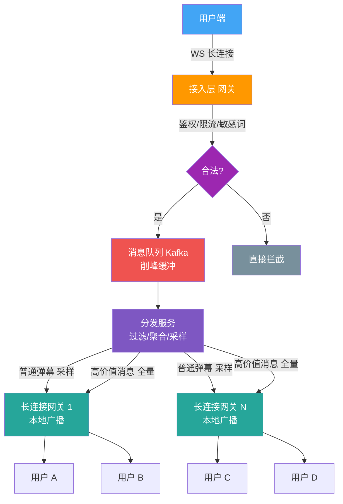
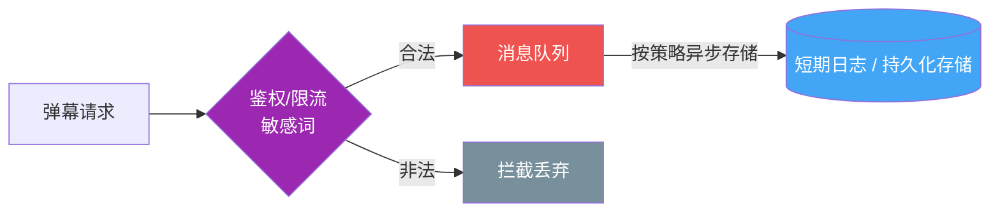
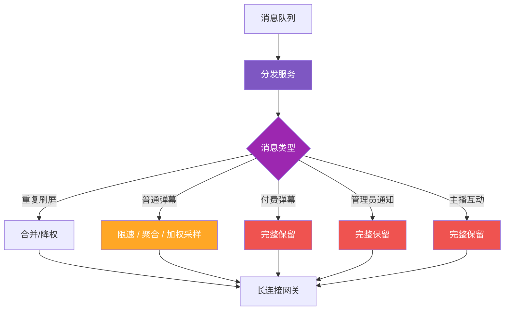
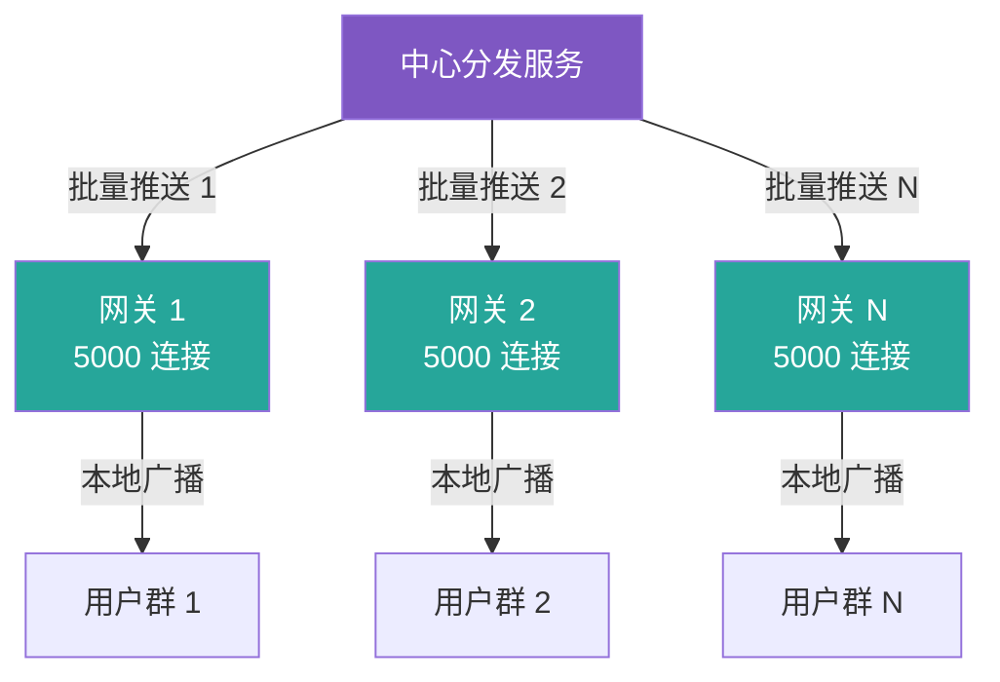
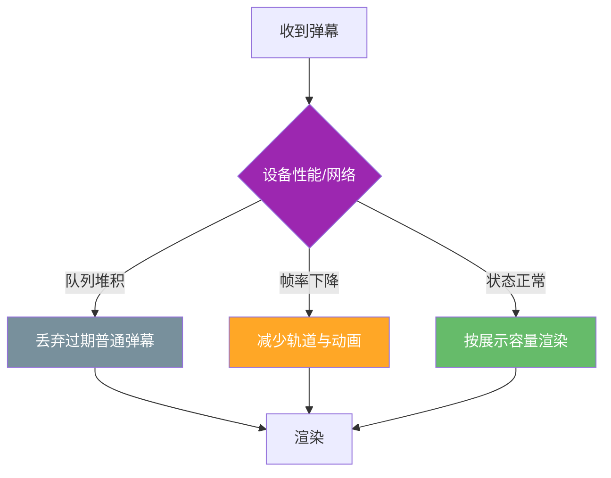

## 弹幕系统的核心思路

弹幕系统和 IM、Feed 流看着像，差异却很大：

| 维度 | 典型 IM 会话 | 大型直播间弹幕 |
|---|---|---|
| 实时性 | 秒级可接受 | **百毫秒级** |
| 可靠性 | 通常要求可重试、可补拉 | 普通弹幕可以采样或丢弃 |
| 历史消息 | 通常支持离线拉取 | 多数场景只关注短时间窗口 |
| 核心目标 | 可达、可恢复、有序 | **低延迟、流畅、稳定** |

这种"允许丢、但要稳"的特性，决定了弹幕系统必须采用**有损服务**设计。

> 普通弹幕允许丢失、不全量送达，但必须保障系统整体稳定；付费、管理员、主播互动等高价值消息进入优先级更高的可靠通道，通过持久化、确认、重试和补偿尽量保证送达。这里的目标是分级保障，而不是承诺任何情况下都绝不丢失。

---

## 整体架构



五层结构：

1. **入口层**（网关）：限流、鉴权、敏感词
2. **消息层**（MQ）：削峰、缓冲
3. **处理层**（分发服务）：过滤、聚合、采样
4. **广播层**（长连接网关）：二级广播
5. **客户端**：兜底降级

---

## 一、入口层：校验与限流

用户弹幕请求**先经过接入层**，完成：

- **鉴权**：登录态校验
- **禁言校验**：被禁言用户直接拦截
- **频率限制**：单用户每秒最多 N 条
- **内容预检**：轻量规则在入口拦截，复杂审核交给独立内容安全服务

合法弹幕进入消息队列或专用实时流通道，业务链路不应同步等待数据库落盘。是否所有弹幕都持久化，要根据回放、审核和合规要求决定；普通弹幕可以只保留短期日志或采样数据，高价值消息则应进入可靠存储。

> 💡 为什么走 MQ 而不是直写 DB？
>
> 十万级直播间可能出现很高的瞬时写入峰值。直接把每条弹幕同步写入关系型数据库，会让请求延迟受连接池和磁盘写入影响。消息队列作为缓冲区，可以把短时洪峰转换成后端可控的消费速率。



**常见 MQ 选型**：

| MQ | 主要特点 | 选型关注点 |
|---|---|---|
| **Kafka** | 分区模型成熟、生态完整、擅长高吞吐流处理 | 分区规划、端到端延迟、消费积压 |
| **RocketMQ** | 路由和消息能力丰富，支持多种业务消息模型 | 运维体系、顺序消息和重试语义 |
| **Pulsar** | 存算分离、多租户能力较强 | 组件复杂度、团队经验和运维成本 |

不存在脱离部署规模和团队能力的固定首选。最终吞吐还取决于分区数量、消息大小、副本数、确认级别、网络和消费逻辑，应通过接近真实流量的压测确定容量。

---

## 二、处理层：过滤 + 聚合 + 采样

分发服务从队列拉取消息后，**不会全量推送**：

| 消息类型 | 处理方式 |
|---|---|
| **重复刷屏**（同一用户相同内容） | 合并 / 降权 |
| **普通弹幕** | 限速、聚合或按质量加权采样 |
| **付费弹幕（醒目留言）** | 完整保留、优先推送 |
| **管理员通知** | 完整保留、强制弹出 |
| **主播互动消息** | 完整保留、高亮显示 |



> 💡 为什么要采样？
>
> 单个屏幕在一段时间内能够清晰展示的弹幕数量有限。服务端即使推送远超展示容量的数据，客户端最终也只能丢弃或遮挡。因此系统应根据屏幕轨道数、展示时长和终端能力控制下发速率。

限流和采样是两个不同环节：令牌桶、滑动窗口用于控制单位时间内允许通过的数量；采样负责在超出展示容量时决定保留哪些消息。采样不应只做纯随机丢弃，还要兼顾时间均匀性、内容质量、用户去重和消息优先级。

- 每个房间 1 秒内最多推送 N 条
- 超出的弹幕进入降级队列（延后或丢弃）

---

## 三、广播层：二级广播

```
中心分发服务 → 多台长连接网关 → 本地广播
```

为什么不中心直推？

如果 10 万用户都在线，中心分发服务直接维护并遍历所有连接，会同时承担连接状态、消息复制和下行带宽压力。把连接分散到多台网关后，中心层只向网关发送房间消息，最终的连接级扇出由各网关并行完成。

二级广播的好处：

| 角色 | 职责 | 数量 |
|---|---|---|
| **中心分发服务** | 把整理好的批量推给每台网关 | 少量（几十台）|
| **长连接网关** | 本地广播给自己维护的在线用户 | 按连接数和带宽水平扩展 |



假设：

- 1 台网关维护 **5000 个 WebSocket 连接**
- 10w 用户 → 需要 **20 台网关**
- 中心服务只需推 20 次，**不再是 10w 次**

> 💡 二级广播的本质：把中心节点的一对多压力，沿分层树状拓扑分摊到多台连接网关。总下行数据量并没有消失，只是被并行分担。

---

## 四、客户端：兜底降级

终端设备不能无上限接收和渲染弹幕，应根据帧率、队列长度、屏幕轨道和网络状态动态调整：

- 队列持续堆积：优先丢弃过期的普通弹幕
- 帧率下降：减少同屏轨道与动画数量
- 网络波动：批量接收，并跳过已经失去时效的消息
- 渲染频繁：使用 Canvas、对象池或批量更新降低布局与绘制压力



> 💡 客户端降级是最后一道防线。即使服务端漏过去 1000 条弹幕，**客户端也能自我保护**。

---

## 核心设计哲学

| 原则 | 体现 |
|---|---|
| **有损服务** | 普通弹幕可丢，业务目标不是 100% 送达 |
| **分层解耦** | 五层职责分离，限制故障扩散范围 |
| **优先级** | 付费 > 管理 > 主播 > 普通 |
| **端到端降级** | 服务端 + 客户端双重兜底 |
| **削峰填谷** | MQ 缓冲瞬时洪峰 |
| **二级广播** | 把连接级扇出分摊到多台网关 |

---

## 面试话术

> 弹幕系统本质是**分级保障 + 有界资源**的设计。普通弹幕可以限速、聚合或采样，高价值消息进入具备持久化、确认、重试和补偿能力的可靠通道。多级保护链路包括入口限流、队列削峰、分发聚合、网关二级广播和客户端背压。核心目标是系统可用，同时尽可能保障关键消息，而不是承诺所有消息百分之百实时送达。

---

## 延伸思考

- **实时性怎么保证？** P99 延迟做到 200ms 以内怎么做？
- **长连接怎么保活？** WebSocket 心跳 + 重连机制
- **网关怎么水平扩展？** 路由表与一致性哈希分配普通房间，超大热点房间再独立拆分广播分片
- **弹幕数据怎么存？** 根据回放、审核和合规周期设计短期热数据与长期归档
- **敏感词过滤怎么做？** 基于 Trie 构建 AC 自动机，再结合规则和内容安全服务
- **如何防刷？** 设备指纹 + 行为分析 + 验证码三层
