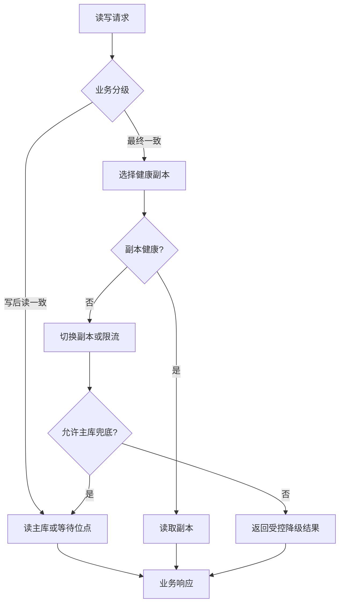
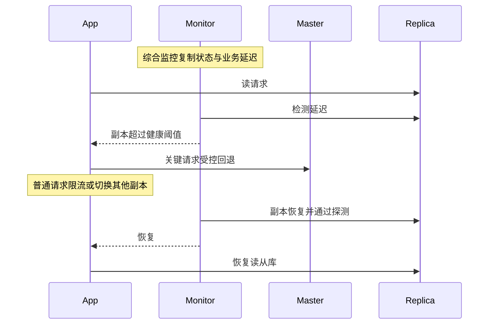

## 读写分离的面试分水岭

读写分离经常被概括成一句话：**主库承担写入，副本负责查询，通过拆分流量降低主库压力。**

这个概括没有错，但它省略了最重要的工程边界：主库提交成功，不代表副本已经回放到同一个位置。

> 业务接入读写分离后，用户支付成功，订单数据已经写入主库，可紧接着打开详情页时仍显示「待支付」。主库状态已经是「已支付」，副本却暂时没有回放到最新位置。

这就是典型的复制延迟问题。真正需要解决的不是「如何让所有读取都强制走主库」，而是「哪些请求需要写后读一致性，以及如何只让这些请求读取足够新的数据」。

这正是读写分离的**幽灵陷阱**——你以为加个从库就能解决读压力，却没想到主从延迟会让用户看到过期数据。

---

## 问题的核心是什么

问题的核心不是会不会配置复制，而是能否为不同业务定义一致性目标，并让路由、监控和降级策略共同满足这个目标。

一套可落地的方案通常包含三层防御。



---

## 第一层：业务分级 — 区分写后读一致性和最终一致性

这是最关键的设计：按业务场景区分读写路径。

### 写后读一致性（读取足够新的数据）

对于刚写入且必须立即可见的数据，应读取主库、等待副本追上指定位置，或选择已经满足最低版本的副本：

- **下单成功后跳转的订单详情页** — 请求直接走主库查询
- **支付结果确认页** — 用户最关心的状态必须立刻看到
- **余额/钱包相关** — 写入后马上要看的数值

```sql
-- 写后读场景：直接查主库
SELECT * FROM orders WHERE order_id = ? /* + route to master */
```

### 最终一致性读（可以走副本）

对于**历史数据**、**报表查询**等可以接受短暂延迟的：

- **只读内容列表** — 允许短时间内看不到最新发布内容
- **非实时统计和趋势页** — 对秒级延迟不敏感
- **数据分析报表** — 本就是离线任务

是否允许读旧数据应由业务语义决定，而不是简单根据数据创建时间判断。三个月前的订单也可能刚发生退款或状态变更，仍然需要读取最新结果。

```sql
-- 最终一致场景：走从库
SELECT * FROM orders WHERE user_id = ? AND created_at < ? /* route to replica */
```

---

## 第二层：读写分离的降级与兜底

当副本延迟或复制中断时，需要及时摘除异常副本，并为真正需要一致性的请求提供受控兜底。不能把所有流量无条件切到主库，否则故障会从副本扩散成主库过载。

### 1. 延迟监控

`Seconds_Behind_Source`（旧版本名为 `Seconds_Behind_Master`）可以作为参考，但它可能为 `NULL`、为 `0` 却仍存在数据差距，也不能完整表示应用真正关心的写后读延迟。生产环境通常还要结合复制线程状态、日志位点或 GTID 差距、心跳表时间差和业务探针判断副本是否健康。

副本超过阈值后，优先停止向该副本分配普通查询；只有要求写后读一致且具备容量预算的请求才回退主库，并配合限流和熔断保护主库。



### 2. 版本号或提交位点校验

写入成功时可以返回单调递增的数据版本或数据库提交位点，后续读请求携带这个最低版本要求。如果副本数据版本落后，则等待短暂同步、切换到满足条件的副本，或在容量允许时回退主库。

普通时间戳可能受到时钟精度和并发写入影响，不能天然充当可靠版本号。应优先使用业务版本字段、日志位点或 GTID 等单调标识。

```python
# 写主库后返回版本号
{
    "order_id": "123",
    "status": "paid",
    "version": 42,
    "required_position": "gtid-or-log-position"
}

# 读请求校验
if replica_data.version < expected_version:
    fallback_to_master()
```

### 3. 写后读路由标记

对刚刚完成写入的用户或业务对象，可以设置一个很短的「写后读主库」标记。在标记有效期内，相关读取保持走主库；过期后恢复普通副本路由。

```python
# 写入成功后记录短期路由要求，而不是缓存查询结果
mark_read_your_writes(user_id, ttl=3)

def choose_read_source(user_id):
    if requires_fresh_read(user_id):
        return primary
    return healthy_replica
```

这里缓存的是路由要求，不是可能过期的业务数据。直接把副本查询结果缓存几秒，反而可能延长旧状态的可见时间。

---

## 第三层：架构层优化 — 减少延迟窗口

### 1. 并行复制

开启 **MySQL 的并行复制**，提高从库同步速度，减少延迟。

```ini
# my.cnf (从库)
replica_parallel_workers = 8
replica_preserve_commit_order = ON
```

具体参数名和行为随 MySQL 版本变化，上线前还要通过回放速度、提交顺序和业务负载验证效果。

### 2. 等待指定复制位点

如果数据库和驱动支持，可以在要求写后读一致的查询前等待副本回放到指定日志位点或 GTID，并设置严格的超时时间。副本及时追上后便可直接读取；等待超时再选择其他健康副本或受控回退主库。

固定让业务线程 `sleep` 几十毫秒并不能保证复制已经完成，只会增加请求延迟，在复制积压时仍然读到旧数据，因此不应把它作为一致性方案。

```python
position = write_to_primary(order)

if replica.wait_until(position, timeout_ms=50):
    return replica.query(order.id)
return fallback_with_budget(order.id)
```

### 3. 强制读主库开关

关键链路可以保留强制主库开关，但它应细化到接口、租户或业务对象，并经过主库容量验证。大促期间恰恰是主库最容易被流量压垮的时候，不能把「所有读取切主库」作为默认预案。

```yaml
# config.yaml
read_write_splitting:
  default: replica
  read_your_writes_paths:
    - /api/order/detail
    - /api/payment/confirm
  fallback_qps_budget: 500
  fallback_timeout_ms: 80
```

---

## 这道题考的是什么

| 层级 | 基础回答 | 完整回答 |
|---|---|---|
| **配置层** | 会加从库分摊读压力 | 知道延迟是副作用 |
| **业务层** | 所有读都走副本 | 写后读/最终一致分流 |
| **降级层** | 出了问题再说 | 监控 + 自动降级 + 兜底 |
| **架构层** | 默认配置 | 并行复制 + 位点等待 + 受控主库回退 |

读写分离不是单纯增加副本，而是在读取能力、一致性、故障隔离和主库容量之间做权衡。真正的工程思维，是从「配置驱动」升级到「**业务目标 + 一致性设计**」。

---

## 面试回答模板

> 这道题我会从三层来回答：
>
> **第一层：业务分级**——写后读一致的请求读取主库或等待位点，允许最终一致的请求读取副本。
>
> **第二层：降级兜底**——副本健康监控 + 版本校验 + 写后读路由标记，三道防线。
>
> **第三层：架构优化**——并行复制 + 位点等待 + 有容量预算的主库回退。
>
> 读写分离不是简单的加从库，而是**数据一致性和性能的平衡**。
