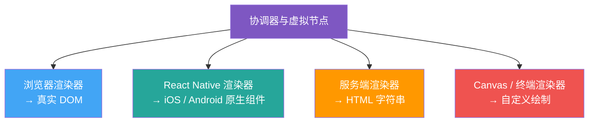
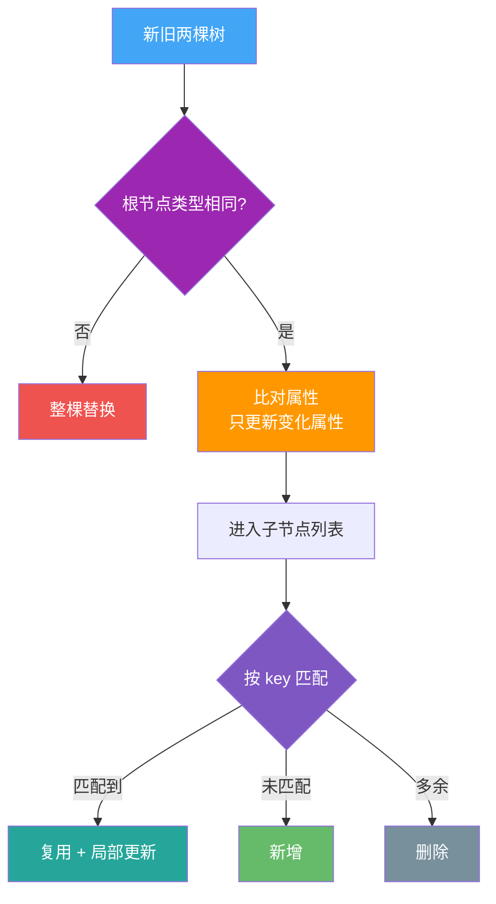

## 破除单一答案的局限

面试官问"为什么需要虚拟 DOM"，最常见的回答是：**为了解决真实 DOM 操作性能差**。

这句话没错，但只说了一半。它忽略了两个绕不开的追问：

1. **Svelte 不依赖传统虚拟 DOM，也能高效更新界面** —— 如果虚拟 DOM 纯粹是为性能而生，为什么还存在编译时方案？
2. **Vue 和 React 最终还是要操作真实 DOM**，多了"生成虚拟树 → diff → patch"这一整条链路，相当于在真实 DOM 之外多绕了一层，为什么还要用？

要答好这道题，得从两个维度讲：一是声明式组件更新如何落到真实界面，二是中间表示如何帮助渲染器与具体平台解耦。虚拟 DOM 是解决这些问题的一种成熟方案，但不是唯一方案。

---

## 一、组件级更新：用一层抽象换开发效率

### 不同框架的更新粒度差异

| 框架 | 更新粒度 | 数据变化时的行为 |
|---|---|---|
| **Svelte** | 编译期生成更新逻辑 | 编译器分析依赖关系，运行时执行针对性的更新代码 |
| **React** | 以组件渲染和协调为核心 | 状态更新会调度相关组件，子组件可通过边界和记忆化跳过工作 |
| **Vue 3** | 组件渲染效应 + 编译优化 | 响应式依赖触发组件更新，静态提升、Patch Flag 和 Block Tree 缩小比对范围 |

关键点在于：React 和 Vue 通常先在组件更新边界内重新计算声明式 UI，再由协调过程判断哪些宿主节点需要变化。它们并不是简单地把每个状态字段直接绑定到某一个 DOM 操作；同时，记忆化、静态提升和编译标记也会让大量稳定子树跳过重复工作。

声明式代码每次只描述「现在的 UI 应该是什么」。框架还需要一种协调机制，把新描述转换为有限的真实界面操作，而不是每次销毁并重建整个页面。虚拟 DOM 就是其中一种运行时中间表示。

### 虚拟 DOM 怎么解决这个问题

虚拟 DOM 是一层用普通 JS 对象描述 UI 结构的轻量模型。数据更新后：

1. **生成新的 UI 描述**：相关组件执行，生成新的虚拟节点；静态或已跳过的子树不一定重新创建。
2. **协调比对**：根据节点类型和 `key` 等信息，用启发式规则定位需要变化的部分。
3. **提交更新**：把差异翻译成一组必要的宿主环境操作，例如 DOM 的增、删、改。

> 注意：虚拟 DOM 不是「比手写的精准 DOM 操作更快」，也不保证得到数学意义上的最少操作。它的价值是在声明式组件模型下，用可预测的协调规则减少不必要的宿主环境更新，并把这套复杂度收进框架内部。

### Svelte 的编译时路线

Svelte 走的是另一条路：**编译时优化**。它不在运行时维护虚拟树，而是在 `build` 阶段分析你的代码，直接生成"数据 → 具体 DOM 节点"的命令式更新代码。

| 维度 | Svelte（编译时） | Vue / React（运行时 + VDOM） |
|---|---|---|
| 运行时开销 | 不维护传统虚拟树，但仍有调度和组件运行时代码 | 有虚拟节点创建和协调成本 |
| 更新粒度 | 精确到单个节点 | 精确到组件，再靠 diff 细化 |
| 包体积 | 小组件通常精简，组件增多时生成代码也会增长 | 需要共享运行时与协调逻辑 |
| 开发心智 | 写起来像普通赋值，但灵活性受编译约束 | 心智模型统一，生态庞大 |

> 结论：Svelte 把更多工作前移到编译阶段，某些更新场景下运行时开销更低；React、Vue 等方案则保留更多运行时能力。实际性能取决于应用结构、更新模式、编译优化和框架版本，不能仅凭是否使用虚拟 DOM 下结论。

---

## 二、跨平台：UI 描述与运行环境解耦

除了承担协调过程，虚拟节点还可以作为渲染器与宿主环境之间的中间表示。不过，跨平台能力来自完整的渲染器抽象，并不只是因为存在一棵虚拟树。

### 问题：直接绑死真实 DOM 会怎样

如果框架的渲染逻辑直接依赖浏览器的 `document.createElement`、`appendChild`，那这套代码**只能在浏览器里跑**。你想把它用到：

- 手机 App（iOS / Android 原生组件）
- Canvas、终端或其他自定义绘制环境
- 服务端（把组件渲染成 HTML 字符串做 SSR）

每换一个环境，就得重写一套渲染层。

### 虚拟 DOM 的解法

虚拟节点可以表达一份相对独立于宿主 API 的 UI 描述，渲染器再负责创建节点、设置属性和插入子节点。但节点类型仍可能带有平台语义，例如 Web 使用 `div`，React Native 使用 `View`，因此不能把「更换渲染器」理解成所有界面代码都可以原样跨平台运行。

同一份虚拟 DOM 描述，配不同的"渲染器（renderer）"，就能产出不同平台的真实界面：

> React 的协调器可以通过不同宿主配置连接 React DOM、React Native 等渲染目标。状态管理和部分业务逻辑可以复用，但宿主组件、样式、交互能力仍然需要适配。真正可复用的是组件模型和协调机制，而不是所有 UI 代码。

### 对比：Svelte 的跨平台思路

编译时框架同样可以通过不同代码生成目标支持其他平台，虚拟 DOM 也不是跨平台的必要条件。两者的区别主要在于：一类在运行时解释中间表示，一类尽量在编译期生成目标更新代码；无论选择哪条路线，都需要为具体平台实现适配层。

---

## 三、diff 算法的核心思想（面试深挖）

光说"有 diff"不够，面试官常追问：**怎么比？复杂度多少？**

通用树编辑距离的计算成本很高。React 的协调策略通过两个核心假设，把常见 UI 更新控制在线性量级附近：不同类型的节点通常生成不同子树，开发者可以用稳定的 `key` 标识同级元素。同类型节点复用则是这套规则产生的处理结果。

1. **节点类型不同**：通常替换对应子树，不尝试计算任意跨层移动的最优编辑路径。
2. **节点类型相同**：复用已有宿主节点，并继续比较属性与子节点。
3. **同级列表使用 key**：借助 `key` 识别节点的新增、删除和移动。

> 关键点：`key` 只需要在同级列表中唯一，并且在多次渲染之间保持稳定。会插入、删除或排序的列表应优先使用稳定业务 ID；只有列表静态、不会重排且元素没有独立状态时，数组下标才是可接受的简化选择。

---

## 四、虚拟 DOM 不是银弹

把话说全，才显专业：

- **小页面直接操作 DOM 或编译时方案可能更轻**：虚拟节点创建与协调也有成本，更新路径明确时，精准操作可能更直接。
- **VDOM 不能消除所有性能瓶颈**：它优化的是"更新的最小集合"，但如果你的组件本身就渲染了上万节点且频繁整体重渲染，问题在组件设计，不在 VDOM。
- **真正卡顿往往不只在协调过程**：还要关注组件重复计算、强制同步布局、绘制面积和资源加载。`will-change` 会增加合成层与内存占用，只应在确认瓶颈后谨慎使用。

---

## 面试答题模板

> 虚拟 DOM 是声明式 UI 的一种运行时中间表示。组件更新时，框架根据节点类型和 `key` 等规则协调新旧描述，把变化提交给具体渲染器。它不一定比手写 DOM 或编译时更新更快，也不保证最少操作；价值在于提供统一、可组合的更新模型，并让协调器能够连接不同宿主环境。跨平台仍需要专门的渲染器和平台组件适配。

---

## 延伸思考

- **Vue 3 的编译时优化**：Vue 3 在编译阶段就标记静态节点，跳过它们的 diff，是"运行时 VDOM + 编译时提示"的混合路线，比 Vue 2 快很多。
- **并发渲染**：真正实现可中断、可恢复调度的是 Fiber 数据结构、优先级和调度器；虚拟节点只是输入之一。
- **SSR / hydration**：服务端输出 HTML、客户端恢复交互可以复用组件描述，但首屏和 SEO 收益仍取决于数据获取、流式输出与 hydration 成本。
- **如果让你设计一个无 VDOM 框架**：你会怎么在编译期捕获依赖关系？Svelte 的 `$:` 响应式和 Vue 的编译标记，思路有何异同？
