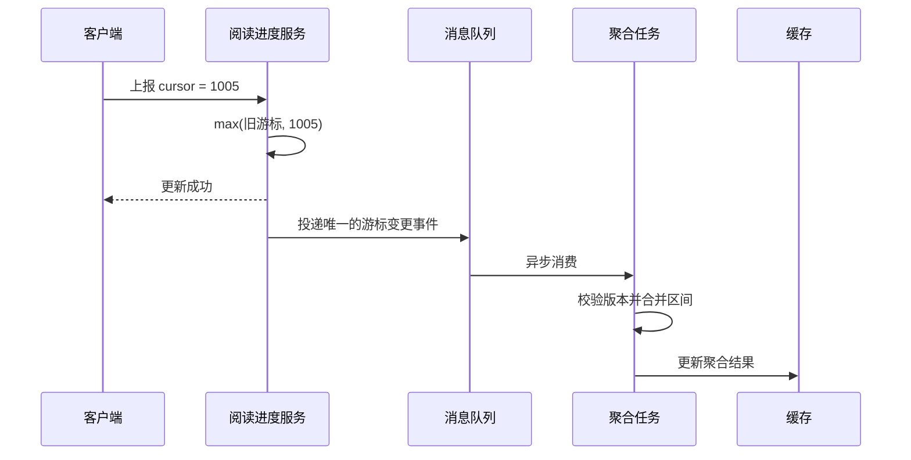
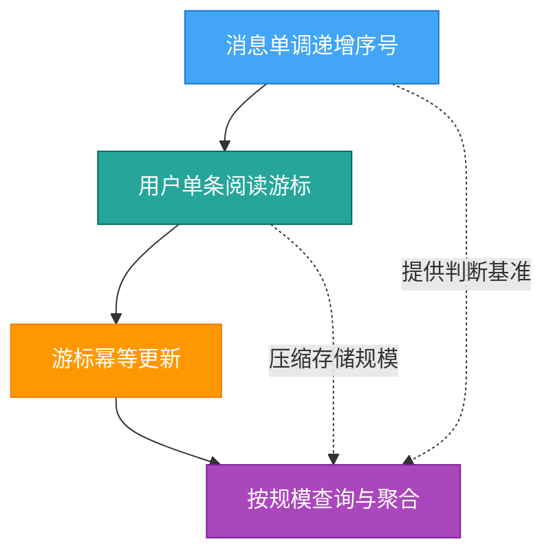

在飞书群聊里，一句看似简单的「已读 32 人」，背后其实串联了客户端可见性判断、多端进度同步、服务端存储压缩和高并发统计等多个环节。

飞书只是一个直观的引例。本文讨论的并不是某个产品的专属实现，而是结合飞书、钉钉、企业微信、Slack 等产品中常见的交互表现，对 IM 系统「已读」功能进行通用架构推演。不同产品会根据隐私策略、业务规模和消息模型采用不同方案，本文也不代表任何产品的官方技术实现。
{: .prompt-info }

## 整体流程


---

## 一、先厘清什么才算「已读」

无论是单聊中的「已读」，还是群聊中的「已读 XX 人」，都不应该简单等同于「用户打开了软件」。更合理的判定方式，是由客户端组合检查以下条件：

1. 用户已经进入目标会话。
2. 目标消息出现在屏幕可视范围内。
3. 部分场景下，聊天窗口还需要处于前台激活状态。

因此，把聊天软件挂在后台、停留在其他会话，或者消息仍在当前屏幕下方，通常都不应该被当作一次有效阅读。

客户端可以通过列表曝光检测、滚动位置和应用生命周期事件，计算出当前真正可见的最后一条消息，再把它作为阅读进度上报给服务端。

不过，滚动过程中不能每出现一条消息就立即发起一次请求。客户端通常还会做三层收敛：只记录本地最大可见序号、通过节流或短延迟合并连续变化、只在游标真正前进时上报。这样既能保持阅读状态及时，又不会把一次快速滚动变成几十次网络请求。

> 「送达」表示消息已经到达用户设备，「已读」表示消息满足产品定义的可见条件。两者是不同的状态，不能混为一谈。
{: .prompt-tip }

---

## 二、核心方案：用阅读游标压缩海量状态

如果为每个用户、每条消息都保存一条阅读记录，数据量会随着会话参与人数和消息数快速膨胀。

假设一个 500 人的群每天产生 10,000 条消息，逐条记录理论上可能形成：

```text
500 × 10,000 = 5,000,000 条阅读关系/天
```

更常见的做法，是引入**阅读游标（Read Cursor）**。

### 1. 为消息分配单调递增序号

会话内的每条消息都有一个可比较、单调递增的序号，例如：

```text
1001 → 1002 → 1003 → 1004 → 1005
```

这个序号可以是独立的消息序列号，也可以来自能够保证会话内有序的消息 ID。重点不在于它是否全局唯一，而在于同一会话内可以稳定排序和比较。

### 2. 一条游标代表此前全部消息

服务端只需要为「用户 + 会话」保存一个最大阅读序号：

| 用户 | 会话 | 最大阅读序号 |
| --- | --- | ---: |
| 用户 A | 技术交流群 | 1005 |
| 用户 B | 技术交流群 | 1003 |
| 用户 C | 技术交流群 | 998 |

用户 A 的阅读游标是 `1005`，就意味着在正常有序消息模型下，序号不大于 `1005` 的消息都可以视为已读。一个数字便压缩了此前成百上千条消息的阅读状态。

### 3. 多端同步时只保留最大值

同一账号可能同时登录手机、电脑和平板。不同设备上报的进度不一致时，服务端只保留其中的最大值：

```text
server_cursor = max(server_cursor, client_cursor)
```

例如，电脑已经读到 `1005`，手机稍后才上报 `1002`，服务端仍然保留 `1005`。这样阅读进度只会前进，不会因为旧设备或延迟请求而回退。

服务端更新成功后，还需要通过长连接或推送事件把最新游标同步给同一账号的其他在线设备；在单聊场景中，也可以把状态变化通知给消息发送方。否则服务端虽然已经记录已读，其他终端的界面却不能及时更新。

### 4. 天然支持重试和幂等

弱网环境下，客户端可能重复上报同一个阅读位置。由于更新规则始终是取最大值，因此：

```text
max(1005, 1005) = 1005
max(1005, 1003) = 1005
max(1005, 1008) = 1008
```

无论同一个请求重复多少次，结果都不会被污染。这让阅读游标天然具备幂等性，也降低了处理网络重传和请求乱序的复杂度。

---

## 三、群聊「已读 XX 人」如何高效统计

有了阅读游标，判断某个用户是否读过某条消息就很简单：

```text
消息序号 ≤ 用户阅读游标  →  已读
消息序号 > 用户阅读游标  →  未读
```

但这里还有一个容易忽略的边界：统计对象不是简单的「当前群成员」，而是这条消息真正面向的有效接收者。成员入群时间、退群时间、消息发送者、机器人以及不可见消息，都可能影响分母。

```text
有效接收者 = 消息发送时具备接收资格的成员 - 发送者 - 不计数对象
已读人数 = 有效接收者中阅读游标不小于消息序号的人数
```

如果每次打开聊天页都扫描所有接收者并逐个比较游标，大群聊和高频刷新场景仍然会给数据库带来持续压力。但把每次游标前进都展开成逐条消息计数，同样可能产生写放大，因此需要根据群规模和访问频率选择方案。

### 1. 中小群：按游标阈值查询

中小群可以为「会话 + 阅读游标」建立有序索引，统计游标不小于目标消息序号的接收者。Redis Sorted Set、数据库联合索引都可以表达这种关系。

这种方式不用为每条消息维护独立计数，写入成本低；代价是每次查看已读人数都需要执行一次范围统计，并结合成员有效期过滤接收者。

### 2. 大群与热点消息：异步聚合

对于成员很多、已读数字刷新频繁的群聊，可以在游标推进后发布变更事件，由异步任务维护消息计数、位图或分桶结果，再把热点统计写入缓存。



上报接口只负责可靠推进阅读进度，耗时的统计工作交给异步任务处理，避免用户滚动聊天页面时被聚合计算阻塞。

异步并不意味着可以无条件重复累加。事件至少需要携带用户、会话、旧游标、新游标和游标版本，并拥有唯一事件标识。消费者应通过版本检查、位图置位或条件更新保证幂等，避免队列重投后把同一个人计算多次。

当一次游标跨越大量消息时，也不应机械地逐条写入所有历史消息。系统可以只聚合近期热点消息，或者用位图、分桶和延迟合并降低写放大。

### 3. 页面优先读取缓存结果

聊天界面通常只需要展示「已读 32 人」这样的汇总数字，因此可以直接读取缓存中的统计结果，让消息列表快速完成渲染。

异步计算意味着数字可能存在很短的最终一致性延迟，但相比每次请求都全量扫描成员，这种取舍更适合高并发聊天场景。缓存只保存可加速查询的派生结果，权威数据仍然是成员关系、消息序号和用户阅读游标；当统计异常或缓存丢失时，应当能够重新计算和校准。

### 4. 点击数字时再加载人员明细

具体的已读成员名单并不是聊天主界面的必需数据。只有用户点击「已读 XX 人」时，系统才需要根据群成员与阅读游标按需查询完整明细。

| 页面场景 | 返回内容 | 推荐数据来源 |
| --- | --- | --- |
| 聊天消息列表 | 已读总人数 | 聚合缓存 |
| 已读详情弹窗 | 具体成员名单 | 实时查询或分页缓存 |

这种「汇总预计算、明细按需查」的方式，把最常见的页面访问做轻，把成本更高的查询留到真正需要时执行。

---

## 四、从群聊案例拓展到完整 IM 系统

阅读游标不只可以解决群聊已读人数，还可以成为单聊回执、未读角标和多设备同步的共同基础。

### 1. 单聊已读回执

在一对一会话中，发送方想知道某条消息是否已读，只需要比较「消息序号」与「接收方阅读游标」：

```text
消息序号 ≤ 接收方阅读游标  →  展示“已读”
消息序号 > 接收方阅读游标  →  展示“未读”或“已送达”
```

与群聊相比，单聊不需要统计人数，只需要读取另一位参与者的游标，因此实现成本更低、状态也更容易实时更新。

### 2. 会话列表未读角标

最简单的连续消息模型中，未读数可以由最新消息位置和阅读游标推导：

```text
未读数 ≈ 最新可计数消息序号 - 阅读游标对应的可计数位置
```

实际系统通常不会直接做两个原始序号的减法，因为撤回消息、系统通知、静默消息等内容可能不计入未读数。常见方案是额外维护「可计数序号」，或者为每个会话维护独立的未读计数器。

### 3. @消息、回执确认等特殊状态

阅读游标适合表达「此前连续消息已经读到哪里」，但不适合承载所有业务状态。例如：

- `@我`、特别关注等提醒需要独立索引，不能随着普通未读数一起丢失。
- 公告确认、审批确认等强回执场景，需要保存明确的用户级确认记录。
- 话题、帖子或子线程拥有独立消息流时，通常需要各自维护阅读游标。
- 用户关闭已读回执或产品启用隐私模式时，服务端还需要控制状态是否对外展示。

这说明「已读」并不总是一个简单的布尔值。底层可以复用阅读游标，但产品层仍要按照业务语义拆分状态。

### 4. 非连续阅读与跳转场景

单条最大游标隐含了一个重要前提：用户读到序号 `1005` 时，可以把此前消息统一视为已读。

如果产品允许用户通过搜索直接跳到一条新消息，却不希望中间消息全部变成已读，那么单游标模型就不够了。此时可以增加已读区间、离散消息记录或「连续游标 + 例外集合」：

| 模型 | 适用场景 | 特点 |
| --- | --- | --- |
| 单一最大游标 | 普通连续聊天流 | 存储最省、判断最快 |
| 多个已读区间 | 经常跨位置跳转 | 表达准确，但合并逻辑更复杂 |
| 游标 + 例外集合 | 大部分连续、少量离散阅读 | 在存储与准确性之间折中 |

大多数聊天产品会优先选择简单、稳定的单游标语义，再针对搜索跳转、话题消息等特殊入口制定额外规则。

---

## 五、四个核心设计要点

整套方案最终可以归纳为四点：

1. **消息单调递增序号**：为阅读进度提供统一、可比较的判断基准。
2. **用户单条阅读游标**：用一个数字代表此前全部消息的阅读状态。
3. **游标幂等更新**：始终取新旧游标最大值，解决多端同步、重试和乱序问题。
4. **按规模查询与聚合**：单聊直接比较游标，中小群按阈值查询，大群对热点消息异步聚合。



看似简单的已读状态，实际上整合了前端可见性识别、多端数据同步、存储压缩与高性能统计等一整套 IM 架构思路。

它最值得借鉴的地方，不是某一个复杂算法，而是通过「有序序号 + 单调游标」把海量离散状态转化为一个可以比较的数字，再按照会话规模选择实时查询或异步聚合。这也是很多大型系统常见的设计方法：**先压缩状态，再拆分实时链路与统计链路。**
