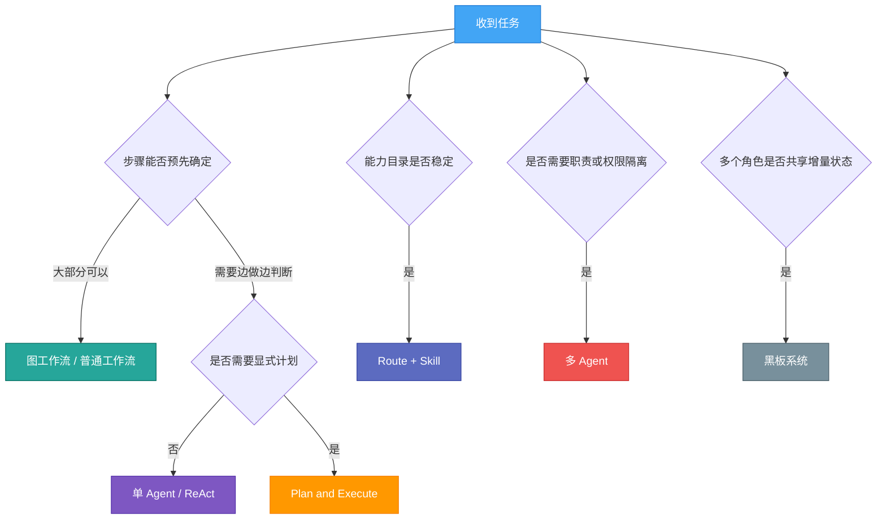
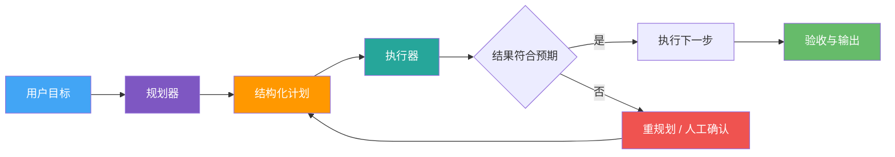
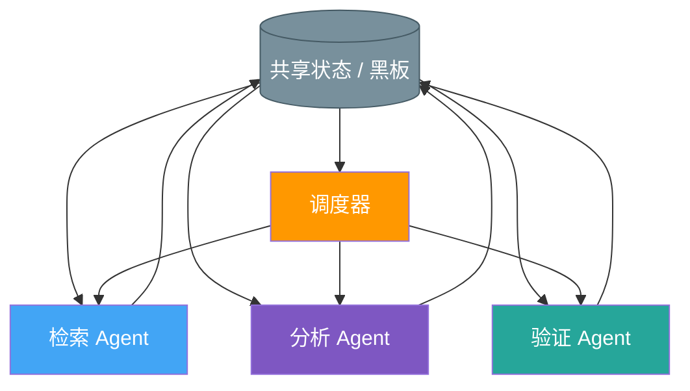
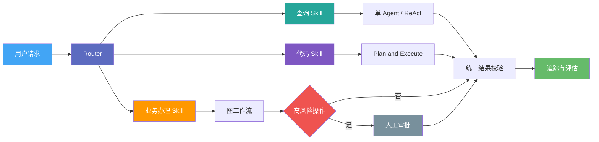

从零搭建一套 Agent 系统时，最容易犯的错误不是模型选得不够强，而是过早把系统设计成「万能 Agent」或庞大的多 Agent 平台。

单 Agent、ReAct、Plan and Execute、多 Agent、Route + Skill、黑板系统和图工作流经常被放在一起比较，但它们并不完全处于同一个抽象层：有的是模型运行循环，有的是任务协作方式，有的是系统编排与状态管理方式。一套真实系统也可能同时使用其中三四种模式。

因此，本文所说的「七种架构」不是行业统一标准，也不是必须依次升级的七个阶段，而是七种常见的工程设计视角。选型的重点，是任务的不确定性、失败代价、状态复杂度和团队能够承担的运维成本。
{: .prompt-info }

## 先给结论

1. **不存在固定的演进路线**：单 Agent、多 Agent 和图工作流不是从低级到高级的关系，生产系统也可以长期使用一个边界清晰的单 Agent。
2. **先区分探索与执行**：开放式探索适合 Agent 循环，步骤固定、失败代价高的流程更适合确定性工作流。
3. **多 Agent 解决的是职责隔离**：只有当不同任务需要不同提示词、工具、权限、上下文或负责人时，拆分才真正有价值。
4. **Route + Skill 适合能力目录稳定的系统**：它尤其适合企业助手和 AI 编程工具，但通常仍要与 Agent 循环、工作流和兜底策略组合，而不是替代它们。



这张图不是互斥选择题。例如，一个代码 Agent 可以先由 Router 选择代码审查 Skill，Skill 内部再运行 ReAct 循环，并把测试、审批和发布交给图工作流。

---

## 一、单 Agent：先把最小闭环跑通

单 Agent 指一个 Agent 对最终任务负责。它可以调用多个工具，也可以进行多轮模型调用，关键不是「只调用一次大模型」，而是规划、工具使用和结果整合都由同一个上下文承担。

```text
用户请求 → 单个 Agent → 调用工具 → 整理结果 → 返回用户
```

### 优点

- 结构简单，提示词、工具权限和状态都集中在一处。
- 模型调用和上下文传递较少，成本与延迟更容易控制。
- 调试链路短，适合先验证任务是否真的需要 Agent。

### 局限

- 工具和规则持续增加后，模型更难稳定选择正确能力。
- 不同任务的上下文混在一起，容易让无关信息影响判断。
- 一个 Agent 同时承担执行、审核和授权，职责边界可能失真。

### 适用场景

知识问答、内容整理、少量工具调用、内部原型，以及工具数量有限的个人助手，都适合从单 Agent 开始。

早期 ChatGPT 更准确地说是以对话模型为核心的聊天产品，不能直接当作现代「工具型单 Agent」的标准样例。真正的单 Agent 系统至少还要定义工具、状态、停止条件和失败处理。

> 如果三个工具就能完成任务，不要为了看起来更像 Agent 平台而先拆出三个角色。先让一个 Agent 稳定完成闭环，再用真实失败案例决定是否拆分。
{: .prompt-tip }

---

## 二、ReAct：在行动结果中继续判断

ReAct 的核心是把推理与行动交替进行。模型不会一次生成完整答案，而是在每轮选择动作，读取工具返回的观察结果，再决定下一步。

```text
判断下一步 → 调用工具 → 读取结果 → 更新判断 → 继续或结束
```

例如，排查线上故障时，Agent 可能先读取监控指标，发现数据库延迟后再查询慢 SQL，随后根据执行计划决定是否继续检查索引。这类任务无法在开始时确定完整路径，ReAct 因而比固定流程更自然。

### 优点

- 能根据环境反馈动态调整，适合搜索、排障和研究任务。
- 工具调用及其观察结果形成操作轨迹，便于定位在哪一步出错。
- 不要求一开始就知道完整执行步骤。

### 局限

- 循环次数不稳定，Token、工具费用和响应时间难以精确预测。
- 可能重复调用工具、过早停止，或者在错误观察结果上继续推导。
- 如果缺少步数、预算、权限和停止条件，任务容易越跑越远。

ReAct 的「可解释性」主要来自可查看的工具调用轨迹，而不是把模型内部思维过程展示给用户。工具轨迹能说明系统做了什么，却不能自动证明模型的解释一定忠实或结论一定正确。

### 适用场景

开放式检索、故障诊断、数据探索、代码库调查，以及需要根据中间结果改变方向的任务。

工程落地时，应补上最大循环次数、工具超时、重复调用检测、费用预算和最终结果校验。ReAct 不是只能用于原型；边界清楚、约束充分时，它同样可以成为生产系统中的一个节点。

---

## 三、Plan and Execute：先拆任务，再逐步执行

Plan and Execute 把规划与执行分开：规划器先把目标拆成步骤，执行器逐项完成，必要时由重规划器根据结果调整剩余计划。



### 优点

- 任务结构清楚，便于展示进度、设置检查点和分配资源。
- 每一步可以使用不同模型或工具，简单步骤不必都调用强模型。
- 适合长任务的中断恢复和阶段验收。

### 局限

- 初始计划依赖不完整信息时，后续步骤可能建立在错误前提上。
- 规划与执行之间需要稳定的结构化协议，否则计划容易在传递中失真。
- 对变化频繁的环境，持续维护计划本身也会产生额外成本。

「初始计划出错，整个任务直接失败」并不是这一模式的必然结果。成熟实现会加入执行反馈、重规划、检查点和人工确认。真正的问题是：系统是否把计划当作不可修改的命令，而不是可被验证的假设。

### 适用场景

代码修改、研究报告、数据迁移准备、批量内容处理，以及步骤较多但可以阶段验收的自动化任务。

---

## 四、多 Agent：按职责、上下文与权限拆分

多 Agent 不是简单地让多个模型同时回答，而是把不同角色的指令、工具、上下文或权限隔离开，再通过明确的协作协议完成任务。

常见方式主要有两种：

1. **管理者调用专家**：主 Agent 保留最终答复权，把检索、计算、审核等子任务交给专家 Agent，再统一汇总。
2. **任务交接**：路由 Agent 把会话控制权交给更适合的专家，后续由专家直接负责该分支。

### 优点

- 每个角色只读取必要上下文，提示词和工具集合更聚焦。
- 可以隔离高风险权限，例如审核 Agent 只读，执行 Agent 才能写入。
- 独立角色便于分别评估、替换模型和追踪故障。

### 局限

- Agent 之间传递信息会增加模型调用、延迟和上下文损耗。
- 任务拆分不合理时，多个角色可能重复劳动或互相等待。
- 最终责任人不明确，会出现无人整合、结论冲突或循环转交。

### 适用场景

需要专业能力隔离、独立权限、并行调查或多阶段审核的复杂任务，例如「研究—撰写—事实核查」和「开发—测试—代码审查」。

多 Agent 不会天然提升流程一致性。它真正解决的是**所有权与边界**；如果协议、终止条件和最终负责人不清楚，拆得越多，协调失败面反而越大。

---

## 五、Route + Skill：让模型在受控能力中选择

Route + Skill 更像一种实用的模块化工程模式，而不是有统一定义的学术架构。

Router 负责识别意图并选择能力，Skill 则封装完成某类任务所需的提示词、知识、工具、参数约束和输出格式。

```text
用户请求 → 规则/模型路由 → 选择 Skill → 受控执行 → 结果校验
```

一个「生成周报」Skill 可以同时绑定数据查询工具、周报模板、字段校验规则和禁止访问的范围。模型不是面对全部工具自由组合，而是在缩小后的能力空间中完成任务。

### 优点

- 能力边界稳定，便于独立测试、版本管理和灰度发布。
- 每次只加载相关说明与工具，可以降低上下文噪声。
- 相同路由或中间结果更容易做缓存，延迟与成本更可预测。
- 评估可以细化到路由准确率、参数正确率和 Skill 成功率。

### 局限

- Skill 之间边界重叠时，Router 容易误判或反复跳转。
- 能力目录变大后，需要维护版本、依赖、权限和发现机制。
- 新需求不在任何 Skill 覆盖范围内时，系统必须知道如何澄清或兜底。

### 适用场景

企业内部助手、客服操作台、数据分析入口、AI 编程工具，以及任务类型相对稳定、工具较多的系统。

原文中「不让模型自由思考，只让模型做选择」过于绝对。Router 可以由规则、分类模型或大模型实现，Skill 内部也可以继续运行 ReAct 或工作流。更准确的说法是：**用受控选择缩小模型的决策空间**。

一个可靠 Router 至少要提供低置信度澄清、无匹配兜底、冲突优先级、权限过滤和路由评估集。否则只是把「工具选错」换成了「Skill 选错」。

---

## 六、黑板系统：围绕共享状态协作

黑板系统让多个独立能力围绕一份共享状态工作。各角色读取当前状态，写入局部结论、待办或证据，再由调度器根据状态变化唤醒下一位参与者。



### 优点

- 参与者不必彼此建立大量点对点连接，只需遵守共享状态协议。
- 适合逐步补全答案、多个专家共同收敛的任务。
- 新角色可以通过订阅特定状态加入系统。

### 局限

- 并发写入容易出现覆盖、脏状态和顺序依赖。
- 状态不断膨胀后，所有 Agent 都可能被无关信息干扰。
- 如果缺少事件版本与变更来源，很难重放「结论如何形成」。

### 适用场景

多专家联合诊断、研究证据汇总、复杂方案设计，以及无法提前确定严格执行顺序的协作任务。

黑板模式与「有共享状态的图执行」可以组合，但不能把 LangGraph 直接等同于黑板系统。前者是状态化工作流编排工具，后者是一种围绕公共知识空间协作的架构思想。

工程上最好把黑板拆成结构化字段、追加式事件和可重建视图，并为写入设置版本、幂等键与所有者，避免所有角色随意改写一大段共享文本。

---

## 七、Graph Workflow：把控制流显式化

图工作流把步骤建模为节点，把转移条件建模为边。节点可以是普通代码、模型调用、Agent、人工审批或外部系统。

它的核心价值不是「用了图就更高级」，而是把原本藏在提示词里的流程、分支、重试和结束条件移到应用层。

### 优点

- 控制流清楚，容易添加条件分支、并行、超时、重试与人工审批。
- 节点可以单独测试和观测，故障后也更容易从检查点恢复。
- 确定性步骤可以直接运行代码，不必让模型重复决策。

### 局限

- 节点和分支持续增加后，图本身会变得难以维护。
- 状态版本、节点幂等和外部副作用仍需业务代码保证。
- 开放式任务很难被提前完整画成固定流程。

### 适用场景

审批、订单处理、内容发布、数据处理、长时间运行任务，以及需要审计、恢复和人机协作的正式生产流程。

这里有两个常见误区需要纠正：

1. **图工作流不一定是 DAG**。LangGraph 强调状态化 Agent 编排，允许循环；循环正好可以表达 Agent 反复调用工具、验证和重规划。
2. **相关工具不属于同一层**。LangGraph 更贴近 Agent 图编排；Temporal 提供持久化执行能力；n8n 是通用工作流自动化平台；Prefect 主要面向 Python 数据与任务编排。它们可能承载相似流程，但抽象、运行时和适用团队不同。

所谓「回溯重试」也不能一概而论。多数工作流引擎支持失败重试或从持久化状态恢复，但已经产生的外部副作用不会自动撤销。扣款、发消息、创建订单等节点仍需幂等键、补偿动作或人工介入。

---

## 七种架构放在一起怎么选

| 模式 | 主要解决的问题 | 控制力 | 运行成本 | 典型风险 |
| --- | --- | --- | --- | --- |
| 单 Agent | 最小任务闭环 | 中 | 低 | 工具和上下文持续膨胀 |
| ReAct | 根据观察动态行动 | 中 | 中到高 | 循环失控、重复调用 |
| Plan and Execute | 长任务拆解与阶段执行 | 中到高 | 中 | 错误计划持续传递 |
| 多 Agent | 职责、权限和上下文隔离 | 中 | 高 | 协调成本、责任不清 |
| Route + Skill | 稳定能力的路由与复用 | 高 | 低到中 | 路由冲突、能力缺口 |
| 黑板系统 | 多角色共享增量状态 | 中 | 高 | 并发状态与追踪困难 |
| Graph Workflow | 显式流程、恢复与审计 | 高 | 中到高 | 图和状态模型复杂 |

选型时可以依次回答五个问题：

1. **任务是开放探索还是固定流程**：越开放，越需要 Agent 循环；越固定，越应该把控制交给代码和工作流。
2. **是否真的需要不同角色**：只有提示词、工具、权限或上下文明显不同，才值得拆成多个 Agent。
3. **状态要保存多久**：一次请求内的临时状态与跨小时、跨天恢复的持久状态，需要完全不同的运行时。
4. **失败能否重试**：读取类工具通常容易重试，付款、发信和发布等副作用必须先设计幂等与审批。
5. **如何证明系统变好了**：至少要有任务成功率、工具调用正确率、端到端延迟、单任务成本和人工接管率。

> 「能跑通一次」只证明提示词在一个样例上有效；能在固定评估集上重复通过，并能解释失败发生在哪个节点，才接近可上线的系统。
{: .prompt-warning }

---

## 更常见的生产方案是混合架构

真实系统很少只属于其中一种模式。一个相对稳妥的企业 Agent 可以这样组合：



Router 先缩小能力范围，Skill 内部根据任务确定性选择 ReAct 或 Plan and Execute，高风险业务再进入带审批与持久化状态的图工作流。这样既保留模型处理不确定问题的能力，也把关键控制权留在系统层。

对于 AI 编程或技能型系统，Route + Skill 的确是很实用的入口架构，因为文件操作、测试、代码审查、部署等能力天然可以模块化。但它不是单独的终点：复杂代码任务仍需要 Agent 循环或计划执行，合并与发布仍需要权限控制、测试和人工确认。

---

## 从零搭建时的推荐顺序

如果现在就要开始实现，可以按下面的顺序控制复杂度：

1. **先做一个单 Agent**：只接入完成核心任务所需的少量工具，并使用结构化输出。
2. **建立评估基线**：收集几十个真实任务，记录成功率、成本、延迟和失败类型。
3. **按失败原因加结构**：工具选错就加 Router，长任务丢步骤就加计划，固定流程不稳定就改成图节点。
4. **按边界拆 Agent**：当某类任务确实需要独立上下文、权限或负责人时再拆分。
5. **最后补生产能力**：加入持久化状态、幂等、审批、追踪、告警、回放和降级。

架构的目的不是让系统看起来更像 Agent，而是让正确的部分由模型判断，让必须确定的部分由代码约束。

单 Agent 负责降低起步成本，ReAct 和 Plan and Execute 处理不同程度的不确定性，多 Agent 与黑板系统解决协作边界，Route + Skill 管理能力目录，图工作流则承接需要恢复、审计和控制的正式流程。它们不是七选一，也不是一条必须走完的升级路线。

真正合适的方案，是在当前业务的成功率、风险、延迟、成本和维护能力之间取得平衡，并且能够随着真实失败逐步演进。
